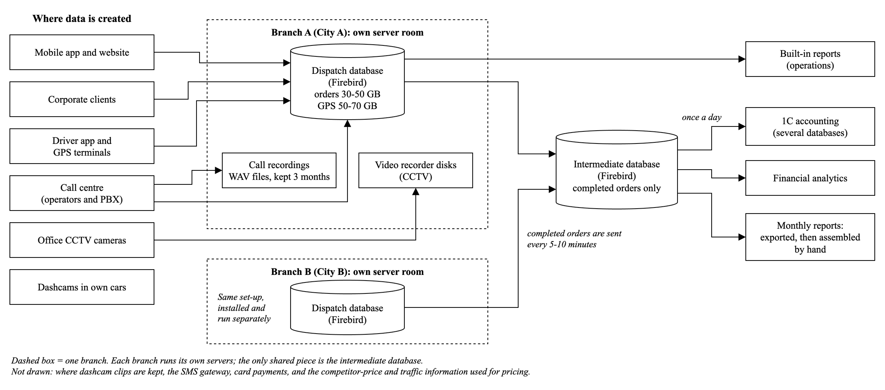
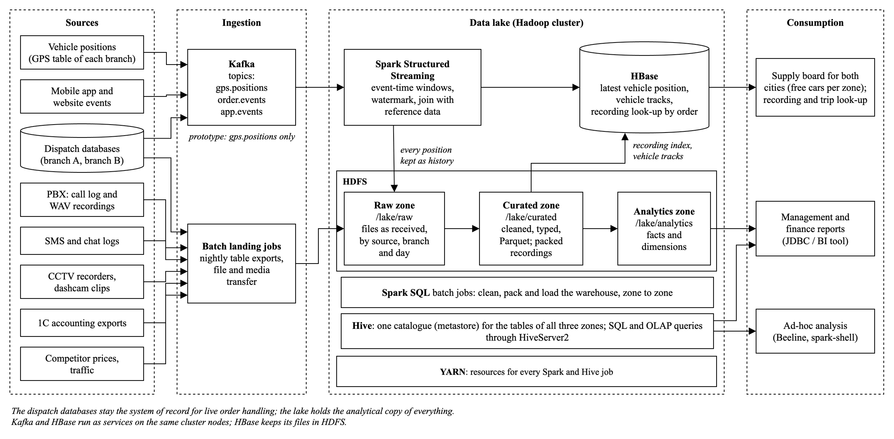

# ISIT312 data lake prototype

Prototype data lake and warehouse for a logistics and transportation company with
two branches, built on Hadoop, Hive, HBase, Spark and Kafka in one container.

## Introduction

**Finding a company.** We first looked for a company in the UAE that works with
big data. We made a profile of about 58 companies and contacted them by email,
WhatsApp and LinkedIn messages. Unfortunately none of them gave us a positive
reply, so we went with an international company based in Russia.

**The company.** A logistics and transportation company with two branches in two
cities: passenger transport, courier and cargo delivery, and tow trucks. The
company prefers not to disclose its name, so in this project it is "the company"
and its cities are City A and City B.

**The data.** The company gave us an initial data set: one day of orders
(851 orders, 95 columns) and vehicle GPS positions (83,761 rows) from branch A,
16 Nov 2026, which we anonymised (`data/real/`). From the columns and rows they
gave us we synthesised the rest: six weeks of order history for both branches
and the sources they could not share, such as the call log, payments, SMS, chat,
app events and accounting, plus stand-in call recordings and video
(`data_prep/`). Findings in the report are drawn from the real data only.

## Data overview

What the company handles, both branches together (approximate):

| Data | Format | Approx. volume |
|---|---|---|
| Orders (dispatch database) | Firebird table, CSV export, 95 columns | ~4,700 orders/day; 30–50 GB of history in branch A |
| Vehicle GPS positions | Firebird table, new rows every few seconds | ~330,000 positions/day; 50–70 GB of history in branch A |
| PBX call log | CSV | ~14,000 calls/day |
| Call recordings | WAV, 8 kHz mono | ~6 GB/day, kept 3 months (~550 GB) |
| Office CCTV | MP4, 1080p, 32 cameras | ~690 GB/day |
| Dashcam clips | MP4, 720p, pulled on request | ~35 clips/day |
| Payments, SMS, chat | CSV, JSON | ~8,500 records/day |
| Mobile app and website events | Nested JSON | ~850 events/day |
| Accounting (1C) | CSV export (cp1251) | Monthly |
| Competitor prices, traffic | JSON, CSV | ~900 rows/day |

Daily figures are estimated from the real extract and the synthetic data built
on it; history sizes and retention are the company's own figures.

**Why a big data solution.** Video and call recordings alone add hundreds of
gigabytes a day (volume), vehicle positions arrive every few seconds from both
cities (velocity), and the data comes as database exports, nested JSON,
accounting files, audio and video (variety). This is more than the company's
current per-branch databases can store and combine, so a Hadoop data lake is a
good fit.

## Architecture

### Before: the company today

Each branch runs its own dispatch database. Only completed orders reach a shared
intermediate database, recordings and CCTV stay on local disks, and monthly
reports are exported and put together by hand.



### After: with our data lake

All sources land in one HDFS lake (raw, curated and analytics zones). Vehicle
positions are streamed through Kafka and Spark Structured Streaming, HBase serves
fast look-ups, and Hive gives one SQL layer for queries and reports.



## Layout

| Folder | What is in it |
|---|---|
| `env/` | Container image, configuration, `lake.sh` / `lakectl`, smoke tests |
| `data_prep/` | Export of the real extract, synthetic sources, media stand-ins |
| `data/real/` | Anonymised sample of the company extract (branch A, 16 Nov 2026) |
| `pipelines/` | Batch ingestion, Spark curation and warehouse build, Hive tables and queries, HBase, streaming, tests, experiments |
| `diagrams/` | Architecture and data model diagrams (draw.io sources and PNG) |
| `evidence/` | `run_all.sh`, logs of the full run, screenshots, Superset dashboard |

`data/synthetic/` and `data/media/` are not in git (too big). Recreate them with
`data_prep/02_generate_synthetic.py` and `data_prep/03_generate_media.py`.

## Running it

See `env/README.md` for the container. In short:

```bash
cd env
./lake.sh up
./lake.sh start-all
cd ..
evidence/run_all.sh      # whole prototype from an empty lake, about 60 minutes
```

## Team

| Member | Student no. | GitHub | Part |
|---|---|---|---|
| Amanuel Michael Gunta | 8087088 | [@amg292](https://github.com/amg292) | Platform and environment: container image, service config, smoke tests, Pig install, experiments E7 (replication) and E8 (object storage) |
| Mohammad Basil | 8780158 | [@mgohar1025](https://github.com/mgohar1025) | Data preparation and batch ingestion: export of the real extract, synthetic sources, media stand-ins, raw zone and its Hive tables, findings on the real extract |
| Ahmad Aldabas | 7920003 | [@Ahmadaldabas](https://github.com/Ahmadaldabas) | Curation and warehouse: Spark curation jobs, warehouse build (fact constellation), curated and warehouse Hive tables, OLAP queries, defect test, conceptual and star schema diagrams, screenshots for the report |
| Daria Demenshina | 7916577 | [@rub1d1i](https://github.com/rub1d1i) | Streaming and HBase: GPS replay to Kafka, Structured Streaming job, restart test, HBase tables, media index, experiments E2 to E6, architecture and streaming diagrams, full run and logs |
| Gakam Gakam Jordan Bryan | 8328997 | [@jordan2371](https://github.com/jordan2371) | Engines and dashboard: experiment E1 (MapReduce, Pig, Hive, Spark), report tables, Superset dashboard, ETL diagrams, slide versions of the diagrams and screenshots |
